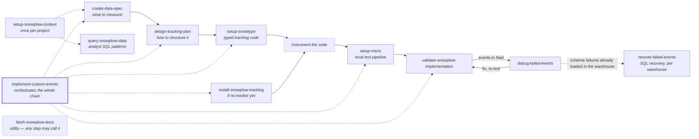

# Snowplow Workflows

Deep, multi-step Snowplow field workflows for AI coding agents — designing tracking plans and data specs, instrumenting trackers, and validating events locally with Micro, through to guided end-to-end custom event implementation.

This repo **complements — it does not replace** — the official [`snowplow`](https://github.com/snowplow/skills) plugin, which bundles the Snowplow MCP server and Console-facing skills (`tracking-design`, `implementation-guidance`, `signals`, `pipeline-infrastructure`, `console-operations`, `troubleshooting`). `snowplow-workflows` skills go deeper on specific field workflows and lean on `snowplow-cli` or the `snowplow` plugin's MCP tools for Console operations rather than bundling their own. Install both.

## Install

### Claude Code (native marketplace)

```text
/plugin marketplace add snowplow-industry-solutions/snowplow-agent-skills
/plugin install snowplow-workflows@snowplow-workflows
```

Claude Code reads the committed `.claude-plugin/` files directly from the repo.

### Any agent (vendor-neutral open-plugin)

```bash
npx plugins add snowplow-industry-solutions/snowplow-agent-skills
```

The CLI auto-detects which agent tools are on your machine (Claude Code, Cursor, Codex) and installs to all of them.

### Skills CLI

```bash
npx skills@latest add https://github.com/snowplow-industry-solutions/snowplow-agent-skills
```

Walks you through an installation wizard to install your chosen skills into your agent harness(es) of choice.

## Console access

`snowplow-workflows` ships no MCP server — it's skills only. For Console operations (schema publishing, pipeline config, enrichments, alerts, tracking-plan CRUD, production troubleshooting), install the official product plugin alongside:

```text
/plugin marketplace add snowplow/skills
/plugin install snowplow@snowplow
```

Where a `snowplow-workflows` skill needs Console access and the `snowplow` plugin's MCP isn't installed, it falls back to [`snowplow-cli`](https://github.com/snowplow/snowplow-cli) where that's a sensible substitute (e.g. the git-backed path through `design-tracking-plan`).

## What's included

### Tracking Design

|Skill|What it does|
|---|---|
| `create-data-spec` | Turns a product spec, PRD, or business goals into a data spec — KPIs, events, entities, identity — then restates it in Snowplow semantics ready for `design-tracking-plan`. |
| `design-tracking-plan` | Designs Snowplow tracking plans, schemas, entities, and event specifications — entity-first modelling, naming, versioning, property instructions — via a git-backed (`snowplow-cli`) or Console-managed (MCP) workflow. |

### Implementation & Testing

|Skill|What it does|
|---|---|
| `fetch-snowplow-docs` | Fetches current Snowplow tracker documentation via the docs sitemap — initialisation, tracking calls, plugins — for any platform. |
| `install-snowplow-tracking` | Installs and configures Snowplow tracking from scratch in web, iOS, Android, or server-side (Node, Python, Java) apps — tracker init, out-of-the-box events, user identification, and stitching server-side events to the client session. |
| `setup-snowtype` | Sets up Snowtype, Snowplow's typed tracking-code generator — tracker detection, sources from Console or local schemas, lock-file and draft handling, dev-vs-prod schema rules — standalone or delegated from `implement-custom-events`. |
| `setup-micro` | Sets up Snowplow Micro locally for testing — Docker config, mounting custom schemas, connecting Iglu registries, enabling enrichments. |
| `validate-snowplow-implementation` | Tests and validates a tracking implementation against Micro — good/bad event counts, attached entities, validation errors, before deploying to production. |
| `debug-failed-events` | Debugs Snowplow events failing validation locally — pasted bad rows, Micro's `/bad` endpoint — with categorized schema resolution, validation, enrichment, and malformed-event fixes. |
| `implement-custom-events` | End-to-end workflow for custom event tracking — discover what to track, design schemas via `design-tracking-plan`, create them in Console, instrument the code, validate in Micro. |

### Project Setup

|Skill|What it does|
|---|---|
| `setup-snowplow-context` | Captures a project's Snowplow working context once — schema vendor, Iglu repos, Console org, MCP availability, schema workflow, warehouse target, tracked platforms, collaboration mode — into `.snowplow/agent-context.md` so every other skill reads it instead of re-asking. |

### Data Analytics & Modeling

|Skill|What it does|
|---|---|
| `recover-failed-events` | Recovers Snowplow schema-validation failed events from a warehouse failed-events table back into the good atomic events table — generates validation-gated recovery SQL through an interactive 8-phase flow, routing on the warehouse (Athena/Iceberg, BigQuery, Databricks, Snowflake). |
| `query-snowplow-data` | Teaches Snowplow-specific SQL patterns for querying atomic data — unnesting entities, deduplication, bot filtering, timestamps, identity and sessions — dialect-correct for Snowflake, BigQuery, Databricks, and Redshift, including Lake Loader Iceberg tables. |
| — | More Analyst skills planned — see [Roadmap](#roadmap) (data-quality debugging, dbt package setup, unified/attribution models, semantic definitions). |

### Governance & Migration

|Skill|What it does|
|---|---|
| — | Planned — no skills shipped yet. See [Roadmap](#roadmap) for the box-by-box mapping (schema audits, custom JS enrichments, anonymous tracking, GA4 → Snowplow and other migration paths). |

## How the skills fit together

The skills compose into one journey — decide what to measure, structure it into a tracking plan, instrument the tracker, prove the events validate — and each is also useful on its own. The diagram shows where each skill picks up and hands off.



Dotted arrows mark delegation, not duplication: `implement-custom-events` drives the other skills in sequence rather than re-implementing them, and `setup-snowplow-context` runs once per project so every later skill reads its context file instead of re-asking. `setup-snowtype` sits between design and instrumentation: with event specs in Console it generates the typed `trackXSpec` functions the instrumentation step calls, and it is equally usable on its own to set up or refresh generated code. Dashed boxes aren't skills — *instrument the code* is your application change, and `fetch-snowplow-docs` is a utility any step can call for current tracker APIs.

**Where do I start?** Pick your entry point by what you already have:

| You have | Start with |
|---|---|
| A PRD or business goals, tracking undecided | [`create-data-spec`](plugins/snowplow-workflows/skills/create-data-spec/SKILL.md) |
| Agreed events and entities, need schemas | [`design-tracking-plan`](plugins/snowplow-workflows/skills/design-tracking-plan/SKILL.md) |
| Event specs in Console, want typed tracking code | [`setup-snowtype`](plugins/snowplow-workflows/skills/setup-snowtype/SKILL.md) |
| "Just do the whole thing, end to end" | [`implement-custom-events`](plugins/snowplow-workflows/skills/implement-custom-events/SKILL.md) |
| An app with no Snowplow tracker yet | [`install-snowplow-tracking`](plugins/snowplow-workflows/skills/install-snowplow-tracking/SKILL.md) |
| Tracking code written, needs verifying | [`setup-micro`](plugins/snowplow-workflows/skills/setup-micro/SKILL.md) → [`validate-snowplow-implementation`](plugins/snowplow-workflows/skills/validate-snowplow-implementation/SKILL.md) |
| Events failing / bad rows | [`debug-failed-events`](plugins/snowplow-workflows/skills/debug-failed-events/SKILL.md) |
| Schema-validation failures already loaded in your warehouse, to recover into the good events table | [`recover-failed-events`](plugins/snowplow-workflows/skills/recover-failed-events/SKILL.md) — routes on the warehouse |
| Data loaded in your warehouse, writing analysis SQL | [`query-snowplow-data`](plugins/snowplow-workflows/skills/query-snowplow-data/SKILL.md) |
| Starting Snowplow work in a fresh repo | [`setup-snowplow-context`](plugins/snowplow-workflows/skills/setup-snowplow-context/SKILL.md) — run it first, once |

## Layout

```
.
├── .claude-plugin/
│   └── marketplace.json          # Claude Code native catalog
├── .plugin/
│   └── marketplace.json          # open-plugin catalog
├── docs/
│   └── snowplow-skills-map.pdf   # source field-skills map behind ROADMAP.md
├── scripts/
│   └── validate.py               # manifest + skill lint — run before every PR
├── skill_design_guidelines/      # skill-authoring conventions and templates
├── plugins/
│   └── snowplow-workflows/
│       ├── .claude-plugin/
│       │   └── plugin.json       # Claude Code native manifest
│       ├── .plugin/
│       │   └── plugin.json       # open-plugin manifest
│       └── skills/               # bundled skills, one SKILL.md directory each
├── README.md
└── ROADMAP.md
```

Two manifest formats coexist so the repo works as both a native Claude Code marketplace and a vendor-neutral [open-plugin](https://github.com/vercel-labs/plugins) bundle — one at the repo root (`marketplace.json`), one per plugin (`plugin.json`). **Keep `.claude-plugin/` and `.plugin/` in sync by hand** whenever metadata changes; `scripts/validate.py --all` checks that the two marketplace catalogs agree and that every plugin source resolves, but it cannot write the fix for you.

## Contributing

Run the validator before opening a PR:

```bash
python3 scripts/validate.py --all
```

New or edited skills should follow the conventions in [`skill_design_guidelines/`](skill_design_guidelines/) — see `skill_design_guide.md` and the `SKILL_TEMPLATE.md` / `SKILL_TEMPLATE_EXAMPLE.md` pair.

If your change adds, renames, or removes a skill — or changes how the skills hand off to each other — update the [How the skills fit together](#how-the-skills-fit-together) diagram and entry-point table to match. The validator fails when that section misses a shipped skill or names one that no longer exists, but only a human can keep the arrows honest.

## Roadmap

Not every field workflow has a skill yet. See [ROADMAP.md](ROADMAP.md) for the full skills-map-to-skill mapping and wave ordering.

## Support

If you have any issues or feedback, create a Github issue.
